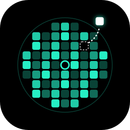
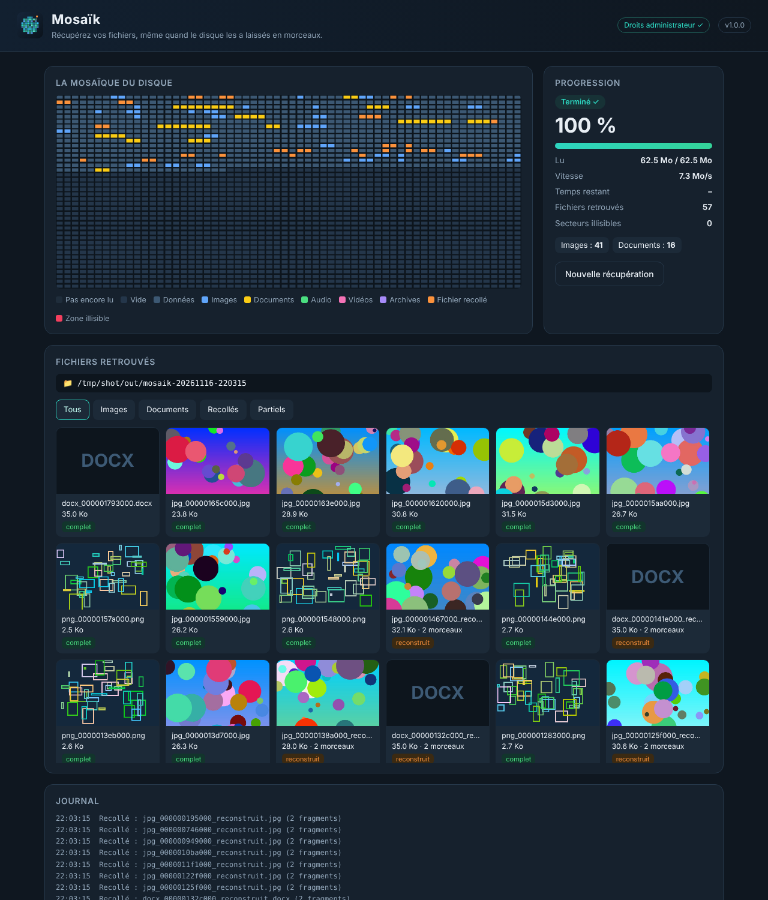
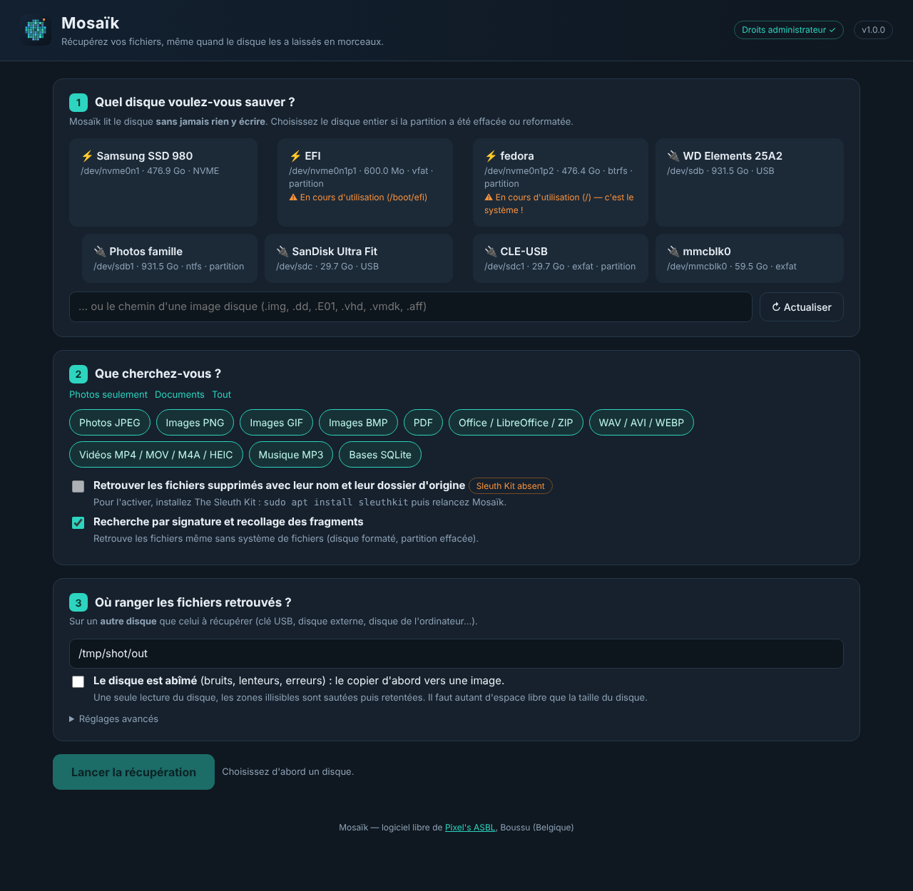

<div align="center">



# 🧩 Mosaïk

### Récupérez vos fichiers, même en morceaux.

**Un récupérateur de données visuel, simple et libre, pour toutes les distributions Linux**

[](LICENSE)
[-blue.svg)](#️-systèmes-compatibles)
[](https://www.python.org/)
[](#️-systèmes-compatibles)
[](#-utilisation)
[](https://www.sleuthkit.org/)
[](https://github.com/asblPixels/Mosaik/actions/workflows/ci.yml)

<br>

[🇬🇧 English](README.md) · [🇫🇷 Français](README.fr.md)

<br>



</div>

---

## 📖 À propos

**Mosaïk** est un logiciel libre de récupération de fichiers pour Linux. Il retrouve les photos, documents, musiques et vidéos effacés ou perdus sur un disque dur, un SSD, une clé USB ou une carte mémoire, **même quand ils sont éparpillés en plusieurs morceaux** sur le disque.

Pendant l'analyse, le disque s'affiche comme une **mosaïque** qui se colore au fur et à mesure : on voit où sont les images, les documents, les zones vides, les zones abîmées et les fichiers recollés. Les fichiers retrouvés apparaissent en direct, avec un aperçu des photos.

> **Origine** : ce projet est créé et maintenu par **[asblPixels](https://github.com/asblPixels)**, dans le cadre de son initiative de logiciels libres. Il est publié sous licence MIT : libre d'utilisation, de modification et de diffusion.

### ✨ Pourquoi Mosaïk ?

Les outils de récupération existants sont soit **en ligne de commande** (PhotoRec, foremost, scalpel, The Sleuth Kit), soit **payants et réservés à Windows**. Aucun ne montre ce qui se passe, et la plupart abandonnent les fichiers **fragmentés**.

Mosaïk veut être **l'outil le plus simple possible** :

- 🖱️ **Trois questions, un bouton** : quel disque ? quoi chercher ? où ranger ? → *Lancer la récupération*.
- 👀 **On voit tout** : la mosaïque du disque, la progression, les photos qui reviennent une à une.
- 🧩 **Les morceaux sont recollés** et le recollage est vérifié.
- 🐧 **Partout** : Fedora, Ubuntu, Debian, Mint, Arch, Manjaro, openSUSE, Gentoo, Void… Python 3 suffit.

### 🆘 Pour qui ?

```
  🗑️ Fichiers effacés   💾 Clé formatée   📷 Carte SD illisible   🔊 Disque qui claque
                 ╲              │                  │                   ╱
                  ╰─────────────┴──► 🧩 Mosaïk ◄───┴──────────────────╯
                                         │
                      📁 Photos · Documents · Musiques · Vidéos retrouvés
```

- 👨‍👩‍👧 **Les particuliers** qui ont perdu les photos de famille.
- 🛠️ **Les ateliers de réparation et repair cafés** qui dépannent le public.
- 🏫 **Les écoles et formations** pour enseigner la récupération de données de façon visuelle.
- 🔎 **Les techniciens** qui veulent The Sleuth Kit avec une interface simple.

## 🎯 Fonctionnalités

### 🧩 Recherche par signature et recollage des fragments

- 🔍 **Recherche par signature** : retrouve les fichiers même quand le système de fichiers a disparu (disque formaté, partition supprimée, table de partitions corrompue).
- 🧩 **Recollage des fichiers fragmentés** (« gap carving ») : quand un fichier est coupé, Mosaïk cherche la suite plus loin sur le disque et **vérifie** le recollage :
  - **PNG** : contrôle CRC de chaque bloc → recollage **certain** ;
  - **Word, Excel, PowerPoint, LibreOffice, ZIP, EPUB** : contrôle CRC de chaque fichier interne → recollage **certain** ;
  - **JPEG** : analyse de la structure et des marqueurs de synchronisation → recollage **probable**, à vérifier en ouvrant la photo.
- 🖼️ **Photos partielles utilisables** : une photo dont la fin manque est complétée pour s'afficher jusqu'à la zone perdue.
- ⚡ **Rapide** : analyse alignée sur les secteurs, en Python pur, sans bibliothèque externe.

### 🏷️ Intégration The Sleuth Kit (noms d'origine)

Si [The Sleuth Kit](https://www.sleuthkit.org/sleuthkit/desc.php) est installé, Mosaïk l'utilise automatiquement :

- 🗂️ **Fichiers supprimés avec leur nom et leur dossier d'origine** (`Photos/Vacances 2023/plage.jpg` au lieu de `jpg_0001a000.jpg`), avec leurs **dates d'origine**.
- 💽 **Partitions** : tables DOS/MBR, GPT, BSD, Mac et Sun.
- 📂 **Systèmes de fichiers** : NTFS, FAT12/16/32, exFAT, ext2/ext3/ext4, HFS+, APFS, ISO 9660, UFS 1/2, YAFFS2.
- 🕵️ **Flux de données alternatifs NTFS** (données cachées dans un fichier).
- 🕒 **Chronologie** de l'activité de tous les fichiers (`chronologie.csv`, à ouvrir dans un tableur).
- 🧱 **Images forensiques** : E01 (EnCase), VHD, VMDK et AFF, en plus des images brutes `.img` / `.dd`.

### 🩺 Disques abîmés

- 💿 **Mode « copier d'abord »** : le disque est lu **une seule fois** vers une image ; les zones illisibles sont sautées, puis retentées secteur par secteur (méthode ddrescue). Le disque fatigué est sollicité au minimum.
- 🟥 Les **secteurs illisibles** apparaissent en rouge sur la mosaïque.

### 🔐 Empreintes et base de hachages

- #️⃣ Empreintes **MD5** et **SHA-256** de chaque fichier récupéré (dans `rapport.csv`).
- 📚 **Base de hachages** facultative (NIST NSRL, HashKeeper, sortie de `md5sum` / `sha256sum`) : les fichiers déjà connus (fichiers système, logiciels) sont signalés pour être écartés facilement.

### 🛡️ Sécurité

- 🔒 Le disque source est ouvert en **lecture seule** : rien n'est jamais écrit dessus.
- 🚫 Mosaïk **refuse d'enregistrer sur le disque analysé**, y compris derrière LVM, RAID ou LUKS.
- 🏠 L'interface n'est accessible **que depuis l'ordinateur lui-même** (`127.0.0.1`), protégée par un jeton aléatoire et contre le « DNS rebinding ».
- 👤 Le navigateur s'ouvre avec **votre compte**, jamais en administrateur ; les fichiers récupérés vous appartiennent.
- 🧯 Les noms de fichiers piégés (`../../etc/passwd`) sont neutralisés.

## 📋 Formats retrouvés par signature

| Famille | Formats | Recollage des fragments |
|---|---|---|
| 📷 Images | JPEG, PNG, GIF, BMP, WEBP, HEIC | ✅ PNG (certain) · ✅ JPEG (probable) |
| 📄 Documents | PDF, DOCX, XLSX, PPTX, ODT, ODS, ODP, EPUB | ✅ formats Office / LibreOffice (certain) |
| 🗜️ Archives | ZIP, JAR, APK | ✅ (certain) |
| 🎵 Audio | MP3 (ID3), WAV, M4A | — |
| 🎬 Vidéos | MP4, MOV, AVI, 3GP | — |
| 🗃️ Bases de données | SQLite (historiques de navigation, messageries, contacts) | — |

Avec The Sleuth Kit, **tous les types de fichiers** supprimés sont retrouvés, avec leur nom, quel que soit leur format.

## 🖼️ Captures d'écran

| Préparation | Analyse |
|---|---|
|  |  |

## 🖥️ Systèmes compatibles

| Élément | Exigence |
|---|---|
| **Système** | N'importe quelle distribution Linux (Fedora, RHEL, Ubuntu, Debian, Mint, Arch, Manjaro, openSUSE, Gentoo, Void, NixOS, Alpine…) |
| **Python** | 3.8 ou plus récent (déjà présent sur presque toutes les distributions) |
| **Bibliothèques** | **Aucune** : uniquement la bibliothèque standard de Python |
| **Interface** | N'importe quel navigateur (Firefox, Chromium, Chrome, Epiphany…) ; mode texte disponible sans écran |
| **Bureau** | GNOME, KDE Plasma, Xfce, Cinnamon, MATE, LXQt… X11 et Wayland |
| **Architecture** | x86_64, ARM (Raspberry Pi), etc. |
| **Droits** | Mot de passe administrateur pour lire un disque (pkexec, sudo ou doas) ; aucun pour analyser une image |
| **Facultatif** | `sleuthkit` pour les noms d'origine, les partitions, la chronologie et les images E01/VHD/VMDK |
| **Espace disque** | Celui des fichiers récupérés ; mode « disque abîmé » : la taille du disque en plus |

## 🚀 Installation

### ⚡ Installation en une ligne

```bash
curl -fsSL https://raw.githubusercontent.com/asblPixels/Mosaik/main/scripts/install-linux.sh | bash
```

Le script :
1. détecte votre distribution ;
2. vérifie Python 3 et propose d'installer **The Sleuth Kit** ;
3. télécharge Mosaïk ;
4. ajoute **Mosaïk** au menu des applications.

> ℹ️ Tant que le dépôt est **privé**, cette commande ne fonctionne pas sans connexion à GitHub : utilisez l'installation manuelle ci-dessous.

### Étape 1 — Télécharger

```bash
git clone https://github.com/asblPixels/Mosaik.git
cd Mosaik
```

> Pas de `git` ? Téléchargez le ZIP (bouton **Code → Download ZIP**) et décompressez-le.

### Étape 2 — (Facultatif, recommandé) Installer The Sleuth Kit

| Distribution | Commande |
|---|---|
| Fedora / RHEL / CentOS | `sudo dnf install sleuthkit` |
| Debian / Ubuntu / Mint | `sudo apt install sleuthkit` |
| Arch / Manjaro / EndeavourOS | `sudo pacman -S sleuthkit` |
| openSUSE | `sudo zypper install sleuthkit` |
| Gentoo | `sudo emerge app-forensics/sleuthkit` |
| Void | `sudo xbps-install sleuthkit` |
| NixOS | `nix-env -iA nixpkgs.sleuthkit` |

### Étape 3 — Installer

```bash
./install.sh
```

Pas besoin de droits administrateur : Mosaïk est installé dans votre dossier personnel (`~/.local`), avec son icône dans le menu des applications.

### Étape 4 — Lancer

Cherchez **Mosaïk** dans le menu des applications, ou tapez :

```bash
mosaik
```

Sans installation, depuis le dossier téléchargé : `python3 mosaik.py`.

### Vérifier que tout fonctionne

```bash
python3 --version                       # 3.8 ou plus
command -v fls icat mmls && echo "The Sleuth Kit OK"
mosaik --version
```

### Désinstaller

```bash
./uninstall.sh
```

Les fichiers déjà récupérés sont conservés.

## 🎬 Utilisation

1. **Lancez Mosaïk.** Votre mot de passe administrateur est demandé (nécessaire pour lire un disque), puis le navigateur s'ouvre.
2. **Quel disque ?** Cliquez sur le disque ou la partition. Choisissez le **disque entier** si la partition a été supprimée ou reformatée. Les disques en cours d'utilisation sont signalés en orange.
3. **Que cherchez-vous ?** Tout est coché par défaut ; raccourcis *Photos seulement* / *Documents* / *Tout*.
4. **Où ranger ?** Sur un **autre disque** (clé USB, disque externe…). Cochez *Le disque est abîmé* s'il fait du bruit ou affiche des erreurs.
5. Cliquez sur **Lancer la récupération** et regardez la mosaïque se remplir. Survolez une photo : sa position s'allume sur la mosaïque.

### Les couleurs de la mosaïque

| Couleur | Signification |
|---|---|
| ⬛ Gris foncé | Pas encore lu |
| 🟦 Gris bleu | Zone vide / données sans fichier reconnu |
| 🔵 Bleu | Images |
| 🟡 Jaune | Documents |
| 🟢 Vert | Audio |
| 🩷 Rose | Vidéos |
| 🟣 Violet | Archives |
| 🟠 Orange | Fichier fragmenté recollé |
| 🔴 Rouge | Zone illisible (secteurs abîmés) |

### Ce que vous obtenez

Les fichiers sont rangés dans `~/Mosaik-recuperation/mosaik-AAAAMMJJ-HHMMSS/` :

```
mosaik-20261116-220315/
├── Noms d'origine/        fichiers supprimés avec leur nom et dossier (The Sleuth Kit)
│   └── partition1_NTFS/Users/Marie/Photos/vacances.jpg
├── Images/                photos et images trouvées par signature
├── Documents/             PDF, Word, Excel, LibreOffice, SQLite…
├── Audio/  Vidéos/  Archives/
├── rapport.csv            liste complète : état, fragments, position, MD5, SHA-256
├── chronologie.csv        activité des fichiers (création, modification, accès)
├── partitions.txt         partitions et systèmes de fichiers détectés
└── LISEZMOI.txt           explication des résultats
```

| État | Signification |
|---|---|
| **complet** | Fichier retrouvé en un seul morceau |
| **reconstruit** | Fichier fragmenté, morceaux recollés et vérifiés |
| **partiel** | Une partie manque ; le début est souvent utilisable |

### Réglages avancés

| Réglage | Par défaut | Rôle |
|---|---|---|
| Recherche profonde | non | Cherche aussi entre les secteurs (plus lent ; anciennes cartes mémoire) |
| Taille de cluster | 4096 octets | Granularité des fragments recherchés |
| Distance max. entre fragments | 1024 clusters (4 Mo) | Jusqu'où chercher la suite d'un fichier coupé |
| Taille minimale | 2048 octets | Ignore les vignettes et miettes |
| Base de hachages | — | Fichier NSRL / md5sum pour repérer les fichiers connus |

### Mode texte (serveurs, live USB, sans écran)

```bash
sudo mosaik --cli /dev/sdb --sortie /media/externe/recup
sudo mosaik --cli /dev/sdb --cloner --sortie /media/externe/recup       # disque abîmé
mosaik --cli disque.E01 --types jpg,png,pdf --hachages NSRLFile.txt     # image forensique
```

| Option | Rôle |
|---|---|
| `--cli SOURCE` | Disque, partition ou image à analyser |
| `--sortie DOSSIER` | Où ranger les fichiers |
| `--types LISTE` | `jpg,png,gif,bmp,pdf,zip,riff,mp4,mp3,sqlite` |
| `--cloner` | Copier d'abord le disque abîmé vers une image |
| `--profond` | Recherche hors des limites de secteur |
| `--sans-tsk` | Ne pas utiliser The Sleuth Kit |
| `--sans-signatures` | Uniquement les noms d'origine (The Sleuth Kit) |
| `--hachages FICHIER` | Base de hachages (NSRL, md5sum…) |
| `--sans-root` | Ne pas demander les droits (pour analyser une image) |
| `--version` | Afficher la version |

## 💡 Conseils pour maximiser les chances

- 🛑 **N'utilisez plus le disque concerné** dès que vous constatez la perte : chaque nouvelle écriture peut écraser vos fichiers. N'installez pas Mosaïk dessus.
- 💾 Récupérez **toujours vers un autre disque** (Mosaïk le refuse de toute façon).
- 🔊 Disque qui claque, ralentit ou affiche des erreurs : cochez **« Le disque est abîmé »** pour ne le lire qu'une fois.
- ⚡ **SSD** : la commande TRIM efface souvent définitivement les données supprimées. Agissez vite, débranchez le SSD si possible.
- 🧊 Disque qui ne tourne plus du tout ou n'est plus reconnu : panne mécanique ou électronique, un logiciel ne peut rien. Ne l'ouvrez pas.

## 🗂️ Structure du projet

```
Mosaik/
├── mosaik.py                 # Moteur + serveur web local + mode texte
├── ui.html                   # Interface (HTML/CSS/JS, sans dépendance)
├── install.sh / uninstall.sh # Installation pour l'utilisateur courant
├── scripts/
│   └── install-linux.sh      # Installation en une ligne (toutes distributions)
├── packaging/
│   └── mosaik.desktop        # Entrée du menu des applications
├── assets/                   # Logo, icônes (SVG + PNG 16→512), aperçu social
├── docs/                     # Captures d'écran
├── tests/
│   └── test_recuperation.py  # Image disque de test avec fichiers fragmentés
├── .github/                  # CI, modèles de tickets
├── CHANGELOG.md · CONTRIBUTING.md · LICENSE
└── README.md · README.fr.md
```

## 🧪 Tests

```bash
pip install pillow
python3 tests/test_recuperation.py
```

Le test fabrique une image disque contenant des photos, un PDF et un document Word, dont **trois fragmentés** (JPEG, PNG, DOCX) au milieu de données parasites, lance Mosaïk et vérifie que chaque fichier est récupéré **à l'identique, octet pour octet**.

## 🐛 Dépannage

### « Lecture impossible de /dev/sdX »
Mosaïk n'a pas les droits administrateur. Relancez-le depuis le menu (le mot de passe est demandé) ou avec `sudo mosaik`.

### Le navigateur ne s'ouvre pas
Copiez le lien `http://127.0.0.1:…/?t=…` affiché dans le terminal et collez-le dans votre navigateur.

### Le disque n'apparaît pas
Cliquez sur **↻ Actualiser**. Vérifiez qu'il est reconnu : `lsblk`. S'il n'y apparaît pas, le problème est matériel (câble, alimentation, adaptateur USB).

### « Le dossier de sortie est sur le disque à récupérer »
C'est une protection : choisissez un dossier sur un autre disque.

### The Sleuth Kit est indiqué « absent »
Installez le paquet `sleuthkit` de votre distribution (voir l'étape 2), puis relancez Mosaïk.

### Une photo « reconstruit » s'affiche avec une bande grise ou décalée
Le recollage des JPEG est probable, pas certain. Gardez la photo : la partie haute est presque toujours correcte. Essayez aussi d'augmenter la *distance max. entre fragments*.

### L'analyse est lente
La vitesse dépend surtout du disque (une clé USB 2.0 lit à ~20 Mo/s). Un disque abîmé peut être très lent : utilisez le mode « disque abîmé ».

## 🤝 Besoin d'un coup de main ?

Mosaïk est créé par **Pixel's ASBL**, un atelier d'inclusion numérique.
Vous ne voulez pas le faire vous-même, ou le disque ne répond plus ? Contactez-nous : nous récupérons vos données ou vous accompagnons pas à pas.

📞 +32 456 96 03 28 · ✉️ info@asblpixels.be · 🌐 [asblpixels.be](https://www.asblpixels.be) · [Facebook](https://www.facebook.com/asblpixels)

⭐ **Le projet vous plaît ? Mettez une étoile au dépôt** : c'est le moyen le plus simple d'aider d'autres personnes à le trouver.

## 🙏 Remerciements

Ce projet s'appuie sur le travail remarquable de :

- **[The Sleuth Kit](https://www.sleuthkit.org/)** (Brian Carrier et contributeurs) : analyse des partitions et systèmes de fichiers.
- **[PhotoRec / TestDisk](https://www.cgsecurity.org/)** (Christophe Grenier) : référence de la récupération par signature, source d'inspiration.
- **[GNU ddrescue](https://www.gnu.org/software/ddrescue/)** : méthode de copie des disques abîmés.
- **[NIST NSRL](https://www.nist.gov/itl/ssd/software-quality-group/national-software-reference-library-nsrl)** : base de hachages de référence.
- La recherche sur le **recollage de fichiers fragmentés** (Garfinkel, Pal & Memon, DFRWS).
- **[Python](https://www.python.org/)** et toute la communauté du logiciel libre.

## 📚 Sources et références

- The Sleuth Kit — description et outils : https://www.sleuthkit.org/sleuthkit/desc.php
- The Sleuth Kit — documentation : https://wiki.sleuthkit.org/
- Format PNG (spécification W3C) : https://www.w3.org/TR/png/
- Format JPEG (ITU-T T.81) : https://www.w3.org/Graphics/JPEG/itu-t81.pdf
- Format ZIP (APPNOTE PKWARE) : https://pkware.cachefly.net/webdocs/casestudies/APPNOTE.TXT
- Format de fichier SQLite : https://www.sqlite.org/fileformat.html
- ISO base media file format (MP4/MOV/HEIC) : ISO/IEC 14496-12
- Simson Garfinkel, *Carving contiguous and fragmented files with fast object validation*, DFRWS 2007
- A. Pal, N. Memon, *The evolution of file carving*, IEEE Signal Processing Magazine, 2009

## 👨‍💻 Créateurs

**Mosaïk** est créé et maintenu par **[asblPixels](https://github.com/asblPixels)** dans le cadre de son initiative de logiciels libres.

Contributions, signalements de bugs et idées sont les bienvenus : voir [CONTRIBUTING.md](CONTRIBUTING.md).

## 📜 Licence

Ce projet est sous licence **MIT** : voir [LICENSE](LICENSE). The Sleuth Kit est un projet distinct (licences IBM Public License / CPL / GPL selon les modules), utilisé uniquement s'il est installé.

## ⚠️ Avertissement légal

Mosaïk est destiné à récupérer **vos propres données**, ou celles d'une personne qui vous a **donné son accord**.

- ✅ Vos disques, clés et cartes mémoire, ou ceux d'un proche / client avec son accord.
- ⚠️ Récupérer les données d'un appareil qui ne vous appartient pas sans autorisation est interdit (vie privée, RGPD).
- ⚠️ Aucun logiciel ne garantit la récupération : les données écrasées ou effacées par TRIM sont perdues définitivement.
- ❌ Mosaïk n'est pas un outil d'expertise judiciaire certifié ; pour une procédure légale, faites appel à un expert.

---

<div align="center">

Fait avec ❤️ par [asblPixels](https://github.com/asblPixels) · Logiciel libre · Licence MIT

</div>
