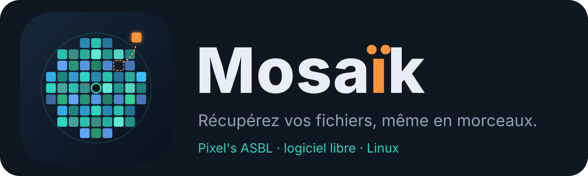

<p align="center">
  
</p>

<p align="center"><b>Récupérez vos fichiers, même quand le disque les a laissés en morceaux.</b><br>
Un logiciel libre de <a href="https://www.asblpixels.be">Pixel's ASBL</a> (Boussu, Belgique).</p>

---

## Ce que fait Mosaïk

Photos effacées, clé USB formatée, disque dur qui fait du bruit, carte SD illisible… Mosaïk retrouve les fichiers et les **recolle quand ils sont fragmentés**, avec une interface visuelle où l'on voit le disque comme une **mosaïque** qui se colore pendant l'analyse.

| | |
|---|---|
| 🧩 **Recollage des fragments** | Quand un fichier est éparpillé sur le disque, Mosaïk cherche la suite et vérifie le recollage (CRC des PNG, CRC des fichiers ZIP/Office, structure et marqueurs des JPEG). |
| 🏷️ **Noms d'origine** | Avec The Sleuth Kit, les fichiers supprimés sont retrouvés **avec leur nom et leur dossier** (NTFS, FAT, exFAT, ext2/3/4, HFS+, APFS, ISO 9660, UFS, YAFFS2). |
| 🩺 **Disques abîmés** | Mode « copie d'abord » : une seule lecture du disque, les zones illisibles sont sautées puis retentées secteur par secteur (méthode ddrescue). |
| 🛡️ **Sans risque** | Le disque source est ouvert en **lecture seule**. Mosaïk refuse d'enregistrer sur le disque qu'il analyse (y compris via LVM, RAID ou LUKS). |
| 🐧 **Toutes distributions** | Un seul besoin : **Python 3.8+**, présent partout. Aucune bibliothèque graphique à installer : l'interface s'ouvre dans le navigateur. |

### Formats retrouvés par signature

Photos **JPEG**, **PNG**, **GIF**, **BMP**, **WEBP**, **HEIC** · **PDF** · **Word / Excel / PowerPoint** (docx, xlsx, pptx) · **LibreOffice** (odt…) · **EPUB** · **ZIP**, JAR, APK · **MP3**, **WAV**, **M4A** · **MP4**, **MOV**, **AVI**, **3GP** · bases **SQLite** (historiques, messageries, contacts).

### Intégration The Sleuth Kit

Si [The Sleuth Kit](https://www.sleuthkit.org/sleuthkit/desc.php) est installé, Mosaïk l'utilise automatiquement pour :

- détecter les **partitions** (tables DOS/MBR, GPT, BSD, Mac, Sun) ;
- identifier le **système de fichiers** de chaque partition ;
- extraire les **fichiers supprimés avec leur nom et leur arborescence**, y compris les **flux de données alternatifs NTFS** ;
- produire une **chronologie** de l'activité des fichiers (`chronologie.csv`, à ouvrir dans un tableur) ;
- lire les images **E01 (EnCase), VHD, VMDK, AFF** en plus des images brutes (`.img`, `.dd`).

Installation de The Sleuth Kit :

| Distribution | Commande |
|---|---|
| Fedora / RHEL | `sudo dnf install sleuthkit` |
| Debian / Ubuntu / Mint | `sudo apt install sleuthkit` |
| Arch / Manjaro | `sudo pacman -S sleuthkit` |
| openSUSE | `sudo zypper install sleuthkit` |

Sans The Sleuth Kit, la recherche par signature et le recollage fonctionnent normalement.

### Empreintes et base de hachages

Chaque fichier récupéré reçoit ses empreintes **MD5** et **SHA-256** (dans `rapport.csv`). On peut fournir une base de hachages (NSRL, HashKeeper, sortie de `md5sum` / `sha256sum`) : les fichiers déjà connus (fichiers système, logiciels) sont signalés pour les écarter facilement.

---

## Installation

```bash
git clone https://github.com/asblPixels/Mosaik.git
cd Mosaik
./install.sh
```

Mosaïk apparaît dans le menu des applications. Pas besoin de droits administrateur pour l'installer.

Désinstallation : `./uninstall.sh` (les fichiers récupérés sont conservés).

## Utilisation

1. Lancez **Mosaïk** depuis le menu (ou la commande `mosaik`). Votre mot de passe administrateur est demandé : il est nécessaire pour lire un disque.
2. Le navigateur s'ouvre. **Choisissez le disque**, ce que vous cherchez, et **où ranger** les fichiers (sur un autre disque).
3. Cliquez sur **Lancer la récupération** et regardez la mosaïque se remplir.

Les fichiers sont rangés dans `~/Mosaik-recuperation/mosaik-DATE/` :

```
Noms d'origine/     fichiers supprimés avec leur nom et dossier (The Sleuth Kit)
Images/  Documents/  Audio/  Vidéos/  Archives/    fichiers trouvés par signature
rapport.csv         liste complète avec état, fragments et empreintes
chronologie.csv     activité des fichiers (dates de création, modification…)
partitions.txt      partitions et systèmes de fichiers détectés
```

États d'un fichier :

- **complet** : retrouvé en un seul morceau ;
- **reconstruit** : fichier fragmenté, morceaux recollés et vérifiés ;
- **partiel** : une partie manque ; le début est souvent utilisable (une photo partielle s'affiche jusqu'à la zone manquante).

### Mode texte (serveur, live USB, sans écran)

```bash
sudo python3 mosaik.py --cli /dev/sdb --sortie /media/externe/recup
sudo python3 mosaik.py --cli /dev/sdb --cloner --sortie /media/externe/recup   # disque abîmé
python3 mosaik.py --cli disque.E01 --types jpg,png,pdf --hachages NSRLFile.txt
```

Options : `--types`, `--cloner`, `--profond`, `--sans-tsk`, `--sans-signatures`, `--hachages FICHIER`, `--sans-root` (analyser une image sans droits administrateur).

## Conseils pour maximiser les chances

- **N'utilisez plus le disque concerné** dès que vous constatez la perte : chaque écriture peut écraser vos fichiers.
- Ne récupérez **jamais** vers le disque analysé (Mosaïk le refuse de toute façon).
- Disque qui claque ou ralentit : cochez **« Le disque est abîmé »** pour le copier une seule fois.
- Disque SSD : la commande TRIM efface souvent définitivement les données supprimées ; agissez vite.

## Sécurité

- Disque source ouvert en lecture seule (`O_RDONLY`), jamais monté ni modifié.
- Interface accessible uniquement depuis l'ordinateur lui-même (`127.0.0.1`), protégée par un jeton aléatoire et contre le « DNS rebinding ».
- Le navigateur s'ouvre avec votre compte, jamais en administrateur ; les fichiers récupérés vous appartiennent.

## Tests

```bash
pip install pillow
python3 tests/test_recuperation.py
```

Le test fabrique une image disque contenant des photos, un PDF et un document Word, dont **trois fragmentés** (JPEG, PNG, DOCX), et vérifie qu'ils sont récupérés **à l'identique**.

## Besoin d'aide ?

L'atelier **Pixel's ASBL** à Boussu peut récupérer vos données pour vous ou vous accompagner pas à pas.

📍 Rue Alfred Dendal 56, 7300 Boussu · ✉️ Info@asblpixels.be · ☎️ +32 456 96 03 28 · [facebook.com/asblpixels](https://facebook.com/asblpixels)

## Licence

Logiciel libre sous licence MIT — voir [LICENSE](LICENSE). The Sleuth Kit est un projet distinct, utilisé s'il est installé.
